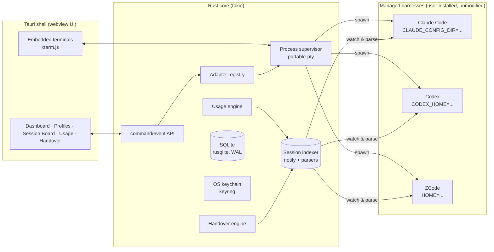

# AI Juggler — Technical Specification

**Status:** draft v0.2 for review (revised after first review round) · **Date:** 2026-10-12
Companion: [proposal](./PROPOSAL.md) · Evidence: [research notes](./research/)

This document specifies the architecture and product behavior of AI Juggler v0.x. Everything here is grounded in the verified findings in `docs/research/`; where a mechanism is version-fragile, the research note is cited.

---

## 1. Overview & constraints

AI Juggler is a native desktop application that **supervises** AI coding harnesses the user already has installed. It never proxies model traffic, never automates vendor logins, and never stores vendor credentials (see proposal §5 guardrails — these are product-level invariants, enforced in code review and tests).

**Non-functional requirements**

| Requirement | Target |
|---|---|
| Platform (v0.1) | macOS 13+ (Apple Silicon & Intel); Windows/Linux by v0.3 |
| Startup | < 1.5s cold start; session board interactive < 500ms after launch |
| Footprint | < 150 MB RSS typical; UI at 60 fps with 20 live sessions |
| Reliability | App crash never kills supervised sessions (children survive; state journaled); recovery on relaunch |
| Resilience | All writes atomic (temp+rename); SQLite in WAL mode; harness-format parse failures degrade, never crash |
| Privacy | No network calls except: update feed check, and user-initiated actions in managed harnesses. Telemetry opt-in only |

**Automation policy (product invariant).** The app *prepares*; the user *executes*. Automated behavior is strictly passive — monitoring, indexing, usage accounting, notifications, alerts, suggestions, and staging of actions. Every state-changing action (switching an account for new work, transplanting a session, priming a target, syncing project context) is bound to an explicit user click; there is no code path that performs one without it (asserted in `tests/guardrails.rs`).

## 2. System architecture



**Layering rules**

- The UI is a thin view; all state lives in the Rust core and is streamed to the UI via Tauri events (pre-aggregated payloads — the webview never parses raw transcripts).
- Only adapters know harness specifics. Core speaks only in domain types.
- Everything on disk is append-only or atomic; nothing in a harness's own directories is ever written except through adapter-defined, user-visible actions (e.g., creating an isolated profile directory).

### Workspace layout (Cargo)

```
ai-juggler/
├── crates/
│   ├── juggler-core/        # domain types, events, storage (SQLite), usage math
│   ├── juggler-adapter/     # HarnessAdapter trait, capabilities, IR schemas
│   ├── juggler-adapters/    # claude-code, codex, zcode implementations
│   ├── juggler-supervisor/  # PTY/process lifecycle, health, stuck detection
│   ├── juggler-handover/    # context packs, rules-file sync, takeover flows
│   └── juggler-app/         # Tauri shell, commands/events, updater wiring
├── ui/                      # frontend (React + TypeScript)
└── docs/
```

## 3. Domain model

```rust
// crates/juggler-core/src/model.rs (sketch)

pub struct HarnessId(Arc<str>);          // "claude-code" | "codex" | "zcode" | ...

pub struct Account {
    pub id: AccountId,
    pub harness: HarnessId,
    pub label: String,                  // "Work Max", "Personal"
    pub plan: Option<PlanTier>,         // max-20x, plus, glm-pro, ...
    pub state_dir: PathBuf,             // the isolated dir AI Juggler manages
}

pub struct Profile {
    pub id: ProfileId,
    pub account: AccountId,
    pub settings_overlay: SettingsOverlay,  // model, permissions, mcp, env
    pub default_cwd: Option<PathBuf>,
}

pub struct SessionRecord {
    pub id: SessionId,                  // juggler's id
    pub native_id: Option<String>,      // claude uuid / codex thread / zcode sess_*
    pub profile: ProfileId,
    pub cwd: PathBuf,
    pub status: SessionStatus,          // Starting|Running|WaitingUser|Stuck|Finished|Failed|HandedOver
    pub started_at: DateTime<Utc>,
    pub last_activity: Option<DateTime<Utc>>,
    pub usage: UsageSnapshot,           // tokens + estimated plan impact
    pub transcript_ref: TranscriptRef,  // pointer into harness-native storage
}

pub struct UsageSnapshot {
    pub tokens: TokenCounts,            // input/output/cache_read/cache_write/reasoning
    pub window: Option<QuotaWindow>,    // 5h/weekly pool state if known
    pub confidence: Confidence,         // Measured | Estimated (Codex) | Computed (ZCode credits)
}
```

**Profiles ↔ harness state isolation** (the mechanism research verified):

| Harness | Isolation primitive | Managed by AI Juggler |
|---|---|---|
| Claude Code | `CLAUDE_CONFIG_DIR=<managed>/claude/<account>/` — settings, sessions, plugins, and (since v2.1.56) a namespaced keychain entry per dir all follow it | Creates dir; first-run `claude login` is launched for the user to complete |
| Codex | `CODEX_HOME=<managed>/codex/<account>/` — config.toml, auth.json, sessions all follow it | Same pattern (`codex login`) |
| ZCode | `HOME=<managed>/zcode/<account>/` — the only complete redirect (research B4: `ZCODE_DATA_BASE_DIR` is insufficient; full `HOME` works). Desktop app remains single-account; managed ZCode profiles use the bundled CLI engine | Creates minimal home + config; `zcode login --no-browser` surfaced to user |

Account *selection* is per-launch and user-initiated; there is no code path that changes the active account of a running session, and no automatic account switching exists anywhere in the codebase (guardrail test: `tests/guardrails.rs` asserts no such API exists).

## 4. Adapter system

The adapter is the extensibility contract. First-class Rust adapters ship for the big three; post-v1, a declarative manifest (TOML) covers simple CLIs without recompiling.

```rust
// crates/juggler-adapter/src/lib.rs (sketch)

bitflags! {
    pub struct Capabilities: u32 {
        const HEADLESS | RESUME | TRANSCRIPT_EXPORT | TRANSCRIPT_WATCH
            | USAGE_TOKENS | USAGE_QUOTA_FEED | PROTOCOL_SERVER | FORK = 0;
    }
}

#[async_trait]
pub trait HarnessAdapter: Send + Sync {
    fn id(&self) -> HarnessId;
    fn capabilities(&self) -> Capabilities;

    /// Detect install, version, and drift vs. versions this adapter was verified against.
    async fn discover(&self) -> DiscoveryReport;

    /// Prepare an isolated account state dir (idempotent) and return launch env.
    async fn prepare_account(&self, dir: &Path) -> Result<EnvMap>;

    /// Build the launch spec for a profile in a given cwd.
    async fn launch_spec(&self, profile: &Profile, cwd: &Path, mode: LaunchMode)
        -> Result<LaunchSpec>;               // argv + env + tty needs

    /// Watch/index native sessions (read-only!).
    fn watcher(&self) -> Box<dyn SessionWatcher>;

    /// Extract usage signals; never performs network calls.
    async fn usage(&self, account: &Account) -> UsageReport;

    /// Export a session to the neutral Transcript IR.
    async fn export(&self, transcript: &TranscriptRef) -> Result<Transcript>;

    /// Prime a new session from a ContextPack (handover in).
    async fn prime(&self, pack: &ContextPack, spec: LaunchSpec) -> LaunchSpec;
}
```

**Design rules**

- Adapters are *read-only* toward native state except for their own managed dirs, and `prepare_account` is the only writer.
- Every parser is versioned: adapters declare `verified_against: ["2.1.296"]`-style ranges; `discover()` warns on drift and capability-probes at runtime (never assumes).
- Session IR is a versioned, neutral schema (`Transcript { meta, messages[], usage[] }`) with per-harness converters — this is what handover and the indexer share.

### 4.1 Adapter: Claude Code (reference implementation)

- **Launch:** real `claude` binary; interactive via PTY, or headless `-p --output-format stream-json` for driven runs. Env: `CLAUDE_CONFIG_DIR=<managed>`.
- **Sessions:** watch `<config_dir>/projects/**/*.jsonl` (notify debouncer); parse lines (`uuid/parentUuid/type/message/usage`) with fixture-tested, version-pinned parser; dedupe by message `uuid` across resumed forks (ccusage pattern).
- **Usage/quota (per research §5):**
  - *Quota feed:* install a managed statusline script per profile dir; its stdin JSON carries `rate_limits.five_hour/seven_day.used_percentage/resets_at` for Pro/Max — captured to the usage engine as **Measured**.
  - *Tokens:* transcript `usage` objects per assistant message → **Measured**.
  - *Exhaustion:* `system/api_retry` rate_limit events (headless), `StopFailure` hook, and transcript pattern matching for "hit your session/weekly limit" (installed as a managed hook in profile dirs) → session status transitions + notifications.
- **Resume:** `claude --resume <id>` / `--continue`; transcript-path resume for cross-dir portability.
- **Prime (handover-in):** launch with the context pack as initial user turn (headless or interactive), or `--settings` overlay for per-session config.

### 4.2 Adapter: Codex

- **Launch:** `codex` with `CODEX_HOME=<managed>`; profiles via adapter-generated `<name>.config.toml` (post-0.134 semantics — separate files, not legacy tables).
- **Control plane (phase 2):** `codex app-server` JSON-RPC (thread/turn lifecycle, approvals) — schemas generated via `codex app-server generate-json-schema` and vendored; phase 1 uses PTY + `codex exec --json` for driven runs.
- **Sessions:** watch `~/.codex… <home>/sessions/**/rollout-*.jsonl`; index from `session_meta` without full replay; `token_usage_record` lines → **Measured** tokens.
- **Usage/quota:** no public API (research §5) — token burn is Measured; plan-credit correlation is **Estimated** (window reconstruction from token timestamps; calibrated as the user observes real resets) and labeled as such in the UI.
- **Resume:** `codex resume` (interactive) / `codex exec resume <id>`.

### 4.3 Adapter: ZCode

- **Launch:** bundled engine at `/Applications/ZCode.app/Contents/Resources/glm/zcode.cjs` via `node`, with `HOME=<managed>`; `--surface terminal`, `-p ... --json` headless; version pinned to the installed app version.
- **Sessions:** read-only queries against `<home>/.zcode/cli/db/db.sqlite` (session/message/model_usage tables) + file watching; WAL mode makes concurrent reads safe.
- **Usage/quota:** **Computed exactly** — `model_usage` token counts + the published credit formula (per-model multipliers, off-peak 50% windows) → exact credit burn per session/account; remote pool totals (5h/weekly) remain as configured plan caps since no public API exists.
- **Resume:** `--resume <sess_id>` / `-c`.
- **Constraints honored:** no reverse-engineered endpoints, no patched binaries — documented/observable surfaces only (research A3/B7).

## 5. Process supervisor

- One tokio task per session. Spawn via `portable-pty` (real TTY) with per-profile env; optional direct child (no PTY) for headless runs.
- Output fan-out: (1) UI terminal buffer (xterm.js via Tauri events, back-pressured ring buffer), (2) heuristic engine, (3) adapter stream parser (stream-json / exec --json) for structured events.
- **Stuck detection heuristics** (all thresholds user-tunable):
  - `no_output && cpu < x% && transcript mtime stale` for N minutes → *Stuck?* (waiting-on-model vs hung disambiguated by CPU/IO),
  - process alive but harness waiting for permission > N minutes → *WaitingUser*,
  - exited non-zero with rate-limit signature → *QuotaBlocked* (distinct status; triggers the handover *suggestion*, never an action),
  - zombie/orphan detection on app restart (children survive app death by design; supervisor re-adopts by PID + log correlation).
- Lifecycle: start, stop (SIGTERM→SIGKILL ladder), attach/detach, and *pause* only where the harness supports it (none do today — pause is emulated at the task level via handover, never by SIGSTOP, which could corrupt in-flight writes).

## 6. Usage engine

- Inputs: per-message token events (all harnesses), quota feed events (Claude Measured; ZCode Computed; Codex Estimated), plan config (tier, window sizes, multipliers) entered by the user and stored per account.
- Outputs: per-session, per-account, per-window aggregates; burn-down projections ("at current rate, 5h window exhausts in ~40 min"); reset timers; threshold alerts (system notifications + tray state).
- Storage: append-only `usage_events` table; rollups materialized nightly and on demand.
- Honesty rule: every number in the UI carries its confidence (Measured/Computed/Estimated) — no synthesized precision.

## 7. Handover & session-sync engine

**Automation policy (product invariant).** The engine *prepares*; the user *executes*. Automated behavior is strictly passive — watching, indexing, accounting, alerting, suggesting, and staging. Every state-changing action (switching an account for new work, transplanting a session, priming a target, syncing project context) is bound to an explicit user click, and there is no code path that performs one without it (asserted in `tests/guardrails.rs`).

The goal is **actual session continuity — sessions and chats moved with their context — not a generated hand-off prompt**. What is achievable depends on what the target harness can natively consume, so the engine always selects the highest tier available and reports which tier it used:

### 7.1 Fidelity tiers

| Tier | Situation | Mechanism | Fidelity |
|---|---|---|---|
| **T1 — Native resume** | Same harness, same account | Adapter-native resume (`claude --resume`, `codex exec resume`, `zcode --resume`) | Lossless: the harness's own session state continues |
| **T2 — Session transplant** | Same harness, different account | Copy the native session artifacts into the target account's managed state dir, then native-resume there (adapter capability `TRANSPLANT`) | Lossless conversation: the target account's harness resumes the identical session, history, and in-session todos |
| **T3 — Transcript replay** | Different harness | Reconstruct the *complete* conversation from the Transcript IR (every user/assistant turn; tool outcomes distilled) and inject it as the target session's opening context via the adapter's priming mechanism | Content-complete: the target model re-reads the real conversation as text and rebuilds its working context from it |
| **T4 — Context pack** | Export/portability fallback; works for any target, including harnesses without adapters | The versioned pack format (§7.3) | Summary-level; user-editable before use |

Honest boundary: no harness exposes model-internal state (KV caches), so nothing can copy that — for anyone, in any tool. T1/T2 are effectively indistinguishable from having started on the target account; T3 preserves the full conversation content, with the target reconstructing its working context from it. A vendor precedent for cross-harness import already exists: Codex ships `/import` of Claude Code/Cursor chats (2026-08-11 changelog) — AI Juggler's version is vendor-neutral and user-triggered.

**T2 mechanics per harness** (adapter capability, fixture-tested):

- **Claude Code:** copy the session `.jsonl` into the target account's `projects/<mangled-cwd>/`; resume by transcript path (supported per CLI reference). Re-transplant ID collisions are resolved by forking (`--fork-session` semantics or a mechanical `sessionId` rewrite).
- **Codex:** copy the `rollout-*.jsonl` into the target `CODEX_HOME` sessions tree; `codex exec resume <session_id>` picks it up. Both accounts share the same installed binary, so format compatibility is guaranteed.
- **ZCode:** sessions live in SQLite; transplant means cloning session rows into the target account's DB — schema-coupled and under investigation. Until verified, ZCode targets use T3, and ZCode sources feed T1–T3 targets natively.

### 7.2 Flows (all execute on click)

1. **Switch profile (one click):** choose which account a *new* session runs under — staged instantly from the profile registry. Running sessions are never switched underneath the user.
2. **Takeover (two clicks):** "Hand over…" on a session → targets listed with the fidelity tier each supports and current quota headroom → click executes: freeze source, transplant or replay, launch target primed, record lineage. The source session always remains resumable (T2 copies; it never moves or destroys).
3. **Return (one click, suggested):** when a source account's window resets (the app alerts), "Resume lineage" resumes the original session natively, primed with a delta of what the takeover session did ("while you were away").
4. **Project context sync (one click, diff-previewed):** align project-level context across profiles working the same repo — rules files (AGENTS.md ↔ CLAUDE.md ↔ `.zcode/AGENTS.md`; AGENTS.md is the emerging standard and Claude Code reads it natively since v2.1.277), harness memory files, todo lists, and uncommitted work. Master copy chosen by the user; every change is shown as a diff before it is applied.
5. **Export/import:** any session exports to a T4 pack file; importing a pack creates a primed session in any managed harness.

### 7.3 Context pack format (T4 + staging/preview artifact)

For exports, and as the always-available preview of exactly what a T2/T3 handover will carry over:

```
pack/
├── PACK.md          # task, constraints, decisions, open TODOs, next steps
├── conversation.md  # the conversation as carried over
│                    # (T3: full replay text; T4: distilled summary + last N turns)
├── state.json       # machine-readable: repo, branch, diff summary, env,
│                    # harness, session ids, pack lineage (A→B→A chains)
└── diffs/           # key patches if not committed
```

Generation is template-driven from the Transcript IR (deterministic; an optional LLM-assisted "smart distill" is a post-v1 feature). `PACK.md` is written to be usable by *any* harness, even one without an adapter.

## 8. Security & privacy

- **Vendor credentials:** never read, copied, or stored by AI Juggler. They live wherever each harness keeps them inside the managed account dir (Claude: namespaced keychain; Codex: auth.json; ZCode: credentials.json). The app's keychain entries hold only AI Juggler's own config encryption key (if needed) — by default nothing.
- **Managed dirs** are 0700; the app runs with normal user privileges, no helpers, no agents.
- **Supply chain:** lockfile-audited deps, `cargo deny`, minimal JS in the webview (no remote content, CSP locked to self).
- **Updates:** Tauri updater, minisign-style signatures, verification cannot be disabled; OS notarization/signing from v0.1 (Apple Developer + Azure Trusted Signing, individual tier — budgeted).
- **Data:** everything local; "export diagnostics" redacts paths/tokens by default.

## 9. App & UX (v0.1 scope)

- **Dashboard:** health strip (accounts × quota rings with reset countdowns), active sessions count, alerts.
- **Profiles:** cards per account (harness icon, plan tier, quota ring, last used); "New profile" wizard (detect harness → name account → open vendor login in guided terminal → verify → done).
- **Session board:** table/grid of live sessions (status chip, harness, profile, cwd, age, tokens, quota impact); row actions: Attach, Open in terminal, Stop, **Hand over…** (wizard).
- **Usage:** per-account timelines (uPlot), windows (5h/weekly/credits), per-session breakdowns, export CSV.
- **Handover:** staged on the session board — "Hand over…" lists target profiles with the fidelity tier each supports and current quota headroom; one click executes (a preview/edit of exactly what will be carried over is always available first).
- **Terminals:** embedded xterm.js tabs (one per session) — *open decision #2: v1 or v2.*
- **Tray:** aggregate quota state, alerts, quick-launch menu. Global hotkey for the board.
- **Settings:** thresholds (stuck heuristics, alert levels), terminal prefs, update channel (stable/beta), telemetry (off).

## 10. Self-update & harness updates

- **App:** `tauri-plugin-updater` + GitHub Releases feed (`latest.json` via tauri-action), staged: download → verify signature → apply on quit or relaunch prompt; channel switch in settings; "check for updates" manual trigger; disable-able entirely.
- **Harness tracking:** adapters' `discover()` records installed versions; a background daily check against vendor release channels (GitHub/npm APIs) surfaces "Claude Code 2.1.301 available (you run 2.1.296)" with the adapter's verified-range status — the app never auto-updates a harness (its updater, your call).

## 11. Storage layout

```
~/Library/Application Support/AI Juggler/        (macOS; XDG on Linux, %APPDATA% on Win)
├── juggler.sqlite          # accounts, profiles, sessions index, usage events, lineage (WAL)
├── accounts/<harness>/<account-id>/   # managed harness state dirs (the isolation roots)
├── packs/                  # context packs + lineage metadata
├── logs/                   # rotated app logs (redaction-aware)
└── cache/                  # parser fixtures cache, rollups
```

Nothing is ever written inside `~/.claude`, `~/.codex`, or `~/.zcode` (the user's pre-existing single-account installs remain untouched; an "adopt existing install" flow *reads* them and offers to fork a managed copy).

## 12. Testing strategy

- **Unit:** usage math (esp. ZCode credit formula vs. published examples), window reconstruction, pack rendering.
- **Fixture corpus:** committed, anonymized transcript samples per harness × version; parsers tested against them; CI job re-verifies against live format dumps monthly (canary).
- **Fake harness adapter:** a script-driven CLI implementing the adapter contract for e2e supervisor/stuck/handover tests — CI runs the full lifecycle headlessly on all three OSes.
- **Guardrail tests:** static + runtime assertions that no code path writes outside managed dirs, performs network calls outside allowlist, exposes account-switching of live sessions, or executes any account switch / handover / project sync without a user-initiated command.
- **UI:** Playwright on the webview for board/wizard flows.

## 13. Milestones

| M | Scope | Acceptance |
|---|---|---|
| **M0** | Workspace scaffold, CI (fmt/clippy/test, 3-OS build), adapter trait + fake harness, domain model + SQLite | Fake session launches, is watched, and shows on a debug board |
| **M1** | Claude Code adapter: account wizard (login hand-off), isolated profiles, parallel launch, session board, embedded terminal *(pending decision #2)* | Two Claude accounts in parallel; zero writes to `~/.claude` |
| **M2** | Codex + ZCode adapters; adopt-existing flow; stuck detection v1 | Three harnesses, one board; stuck heuristics pass fixture corpus |
| **M3** | Usage engine + dashboards + alerts (Claude Measured, ZCode Computed, Codex Estimated); tray | Quota rings within ±5% of vendor-reported for Claude/ZCode |
| **M4** | Handover: packs, takeover/return wizard, rules-file sync, export/import; lineage | Round-trip A→B→A preserves continuity (dogfood criterion) |
| **M5** | Hardening, signed self-update + harness update tracking, onboarding polish → **v0.1 public** | Fresh-machine install → 2 parallel accounts < 5 min |

## 14. Open decisions (blocking review)

1. **UI framework:** React 18 + TypeScript + Tailwind + shadcn/ui *(recommended — ecosystem, prior art in cc-switch/opcode)* vs Svelte 5 *(leaner)*.
2. **Embedded terminal in M1** (recommended yes — it is the daily surface) vs defer to M2.
3. **License:** MIT *(chosen)* vs Apache-2.0.
4. **Naming:** binary `ai-juggler`, crates `juggler-*` *(proposed)*.
5. **MVP order:** Claude Code first in M1 *(recommended — matches founding pain point)*.
6. **Codex control plane phase:** PTY-first *(recommended for M2)* vs app-server-first.
